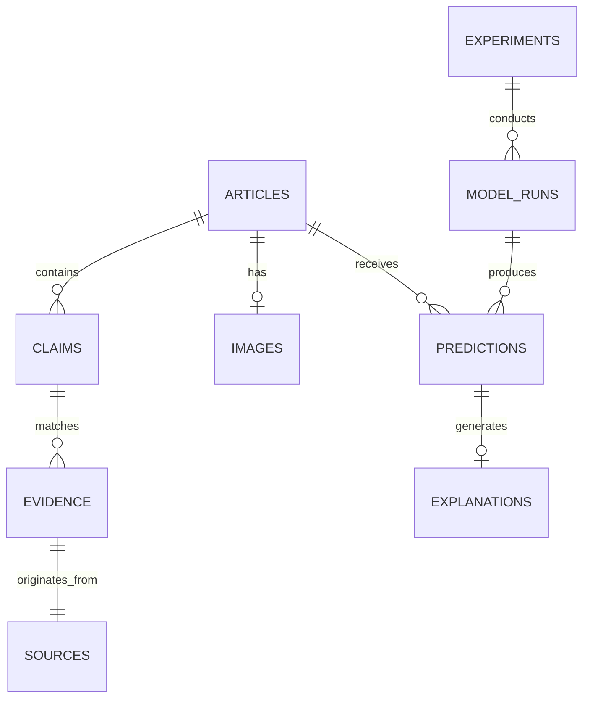

# TruthLens: Database Schema Specification

## 1. Relational Architecture Overview

TruthLens utilizes a normalized relational data model implemented with SQLAlchemy 2.x.
- **Primary Production Engine**: PostgreSQL 16 with `pgvector` extension for dense similarity search.
- **Local / Testing Fallback Engine**: SQLite 3 with `aiosqlite` for asynchronous test isolation.

---

## 2. Core Entities & Entity-Relationship Diagram

---

## 3. Detailed Table Specifications

### 3.1 `articles`
Stores ingested articles, URLs, raw text, and metadata.
- `id`: UUID (Primary Key)
- `url`: String(2048), Nullable, Indexed
- `title`: String(1024), Non-null
- `body_text`: Text, Non-null
- `author`: String(256), Nullable
- `publisher`: String(256), Nullable
- `published_at`: DateTime(timezone=True), Nullable, Indexed
- `created_at`: DateTime(timezone=True), Default `CURRENT_TIMESTAMP`
- `sha256_hash`: String(64), Unique, Non-null, Indexed (deduplication)

### 3.2 `claims`
Atomic factual assertions extracted from articles.
- `id`: UUID (Primary Key)
- `article_id`: UUID, Foreign Key -> `articles.id`, On Delete CASCADE
- `claim_text`: Text, Non-null
- `source_sentence`: Text, Non-null
- `start_char`: Integer, Non-null
- `end_char`: Integer, Non-null
- `salience_score`: Float, Non-null, Default 1.0
- `claim_embedding`: Vector(384) (pgvector) or JSON/Binary (SQLite fallback)

### 3.3 `sources`
Known news publishers and fact-checking institutions.
- `id`: UUID (Primary Key)
- `domain`: String(256), Unique, Non-null, Indexed
- `name`: String(256), Non-null
- `historical_reliability_score`: Float, Default 0.50
- `fact_checker`: Boolean, Default False
- `country`: String(64), Nullable

### 3.4 `evidence`
Individual retrieved external passages verifying or refuting claims.
- `id`: UUID (Primary Key)
- `claim_id`: UUID, Foreign Key -> `claims.id`, On Delete CASCADE
- `source_id`: UUID, Foreign Key -> `sources.id`, Nullable
- `url`: String(2048), Non-null
- `title`: String(1024), Nullable
- `snippet`: Text, Non-null
- `retrieved_at`: DateTime(timezone=True), Default `CURRENT_TIMESTAMP`
- `published_at`: DateTime(timezone=True), Nullable
- `relevance_score`: Float, Non-null
- `stance`: Enum(`SUPPORTS`, `CONTRADICTS`, `NEUTRAL`, `UNKNOWN`), Non-null
- `stance_confidence`: Float, Non-null
- `retrieval_provider`: String(64), Non-null

### 3.5 `images`
Metadata and representations of images associated with articles.
- `id`: UUID (Primary Key)
- `article_id`: UUID, Foreign Key -> `articles.id`, On Delete CASCADE
- `file_path`: String(1024), Nullable
- `sha256`: String(64), Non-null, Indexed
- `ocr_text`: Text, Nullable
- `width`: Integer, Nullable
- `height`: Integer, Nullable
- `format`: String(16), Nullable
- `cross_modal_consistency_score`: Float, Nullable

### 3.6 `predictions`
Verification predictions generated by model pipelines.
- `id`: UUID (Primary Key)
- `article_id`: UUID, Foreign Key -> `articles.id`, On Delete CASCADE
- `model_run_id`: UUID, Foreign Key -> `model_runs.id`, Nullable
- `assessment_state`: Enum(`LIKELY_TRUE`, `LIKELY_FALSE`, `MISLEADING_OR_PARTIALLY_SUPPORTED`, `INSUFFICIENT_EVIDENCE`), Non-null
- `prediction_confidence`: Float, Non-null
- `calibrated_confidence`: Float, Non-null
- `evidence_sufficiency`: Float, Non-null
- `conflict_score`: Float, Non-null
- `latency_ms`: Float, Non-null
- `created_at`: DateTime(timezone=True), Default `CURRENT_TIMESTAMP`

### 3.7 `explanations`
Structured natural language explanations with citation indices.
- `id`: UUID (Primary Key)
- `prediction_id`: UUID, Foreign Key -> `predictions.id`, On Delete CASCADE
- `summary_text`: Text, Non-null
- `evidence_breakdown_text`: Text, Non-null
- `faithfulness_score`: Float, Nullable
- `llm_model_name`: String(128), Non-null
- `prompt_tokens`: Integer, Nullable
- `completion_tokens`: Integer, Nullable
