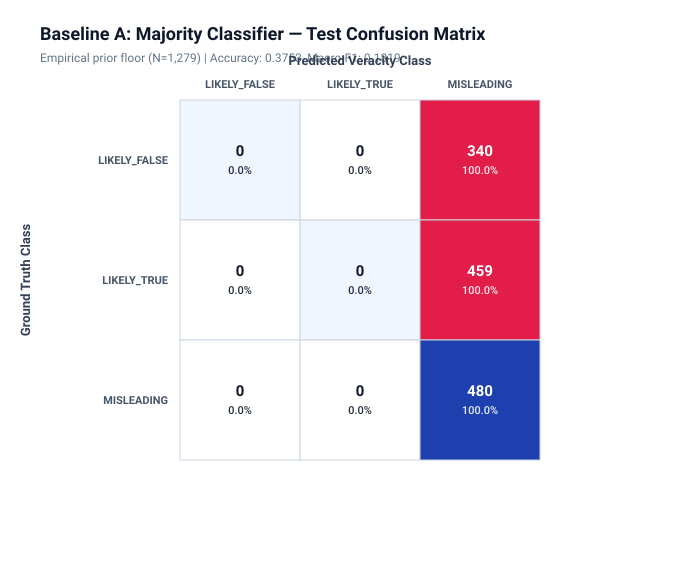
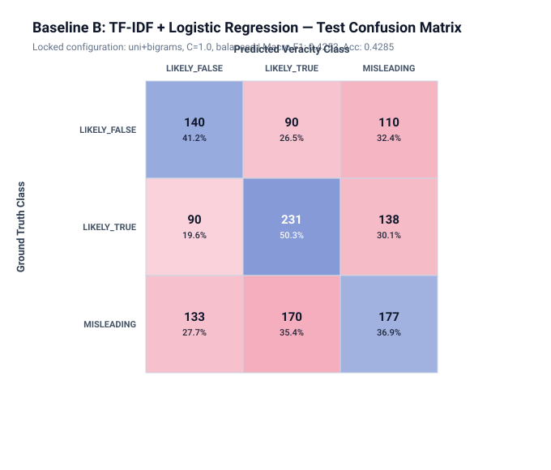
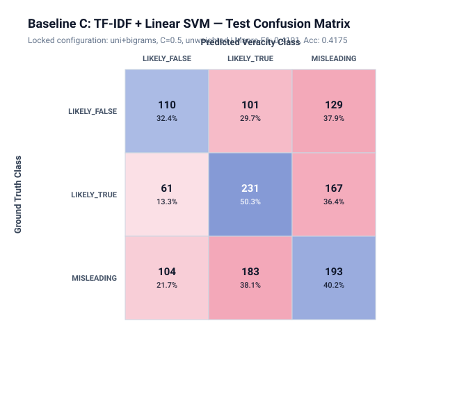

# TruthLens — Phase 4: Classical ML Baselines & Reproducible Evaluation Report

> **Research Note**: This report documents the empirical evaluation of classical text-classification baselines
> on the TruthLens 3-class veracity task. In accordance with the project research protocol, all metrics
> reflect actual executions on the leakage-controlled benchmark without transformer architectures, LLMs, or evidence retrieval.

---

## 1. Dataset Provenance & Split Integrity

| Dimension | Specification |
| :--- | :--- |
| **Benchmark** | UCSB LIAR (Wang, ACL 2017) |
| **Partition Strategy** | Official LIAR benchmark partitions with deterministic cluster-isolation corrections |
| **Precedence Policy** | `TRAIN > VAL > TEST` for cross-split duplicate clusters |
| **Total Analyzed Records** | `12,836` |
| **Training Split** | `10,278` (80.07%) |
| **Validation Split** | `1,279` (9.96%) |
| **Test Split** | `1,279` (9.96%) |
| **Cross-Split Exact Leakage** | `0.00%` (0 matching content hashes) |
| **Cross-Split Near Leakage** | `0.00%` (0 overlapping clusters) |
| **Reassigned Records** | `9` (Quarantined into Train) |
| **Manifest Digest** | `b344c95400cbf91b2fc54fe8e4c06b89506398e7667863bee816d45ca4826330` |
| **Git Checkpoint** | `cfcbf14bc74fe68c602c5133d54e0da8b55c16d3` |
| **Random Seed** | `42` |

### 1.1 Canonical Class Distribution Across Partitions
* **Train**: `{'LIKELY_FALSE': 2846, 'MISLEADING_OR_PARTIALLY_SUPPORTED': 3781, 'LIKELY_TRUE': 3651}`
* **Validation**: `{'MISLEADING_OR_PARTIALLY_SUPPORTED': 485, 'LIKELY_FALSE': 375, 'LIKELY_TRUE': 419}`
* **Test**: `{'LIKELY_TRUE': 459, 'LIKELY_FALSE': 340, 'MISLEADING_OR_PARTIALLY_SUPPORTED': 480}`

---

## 2. Experimental Protocol

```text
TRAIN PARTITION (N=10,278)
  ↓
Fit TF-IDF Vectorizer (Train vocabulary strictly isolated)
Transform Train statement texts
  ↓
Fit Baseline Models (Majority, Logistic Regression, Linear SVM)
  ↓
VALIDATION PARTITION (N=1,279)
Transform Val texts using Train vectorizer
Evaluate candidate configurations
Model & Hyperparameter Selection strictly on Validation Macro-F1
  ↓
LOCK FINAL MODEL CONFIGURATIONS (Zero test contamination)
  ↓
TEST PARTITION (N=1,279)
Evaluate locked models exactly ONCE
Compute final test metrics, confusion matrices, and error analysis
```

* **Primary Model Selection Metric**: **Macro-averaged F1** on the validation partition. Macro-F1 is selected to avoid favoring models that exploit majority-class bias.
* **Tie-Breaking Rule**: Highest Validation Accuracy, then lower training latency.
* **Test Isolation**: The test set was untouched during all preprocessing, vectorizer fitting, and hyperparameter tuning phases.

---

## 3. Validation Model Selection Results

The table below records the empirical validation performance for all candidate configurations evaluated on the validation partition:

| Model | Configuration Description | Val Macro-F1 | Val Accuracy | Val Macro-Prec | Val Macro-Rec | Train Latency |
| :--- | :--- | :--- | :--- | :--- | :--- | :--- |
| `Majority Classifier` | `Constant prediction (MISLEADING_OR_PARTIALLY_SUPPORTED)` | 0.1833 | 0.3792 | 0.1264 | 0.3333 | 0.00s |
| `Logistic Regression` | `unigrams, C=1.0, unweighted` | 0.4266 | 0.4324 | 0.4325 | 0.4266 | 1.28s |
| `Logistic Regression` | `uni+bigrams, C=0.5, unweighted` | 0.4426 | 0.4574 | 0.4592 | 0.4470 | 2.39s |
| `Logistic Regression` | `uni+bigrams, C=1.0, unweighted` | 0.4438 | 0.4543 | 0.4528 | 0.4461 | 2.95s |
| `Logistic Regression` | `uni+bigrams, C=2.0, unweighted` | 0.4332 | 0.4418 | 0.4372 | 0.4350 | 3.90s |
| `Logistic Regression` | `uni+bigrams, C=1.0, balanced` | 0.4512 | 0.4511 | 0.4502 | 0.4538 | 2.40s |
| `Linear SVM` | `unigrams, C=1.0, unweighted` | 0.4059 | 0.4097 | 0.4077 | 0.4058 | 1.50s |
| `Linear SVM` | `uni+bigrams, C=0.5, unweighted` | 0.4351 | 0.4418 | 0.4388 | 0.4365 | 1.46s |
| `Linear SVM` | `uni+bigrams, C=1.0, unweighted` | 0.4269 | 0.4324 | 0.4297 | 0.4279 | 2.44s |
| `Linear SVM` | `uni+bigrams, C=2.0, unweighted` | 0.4300 | 0.4347 | 0.4317 | 0.4308 | 2.23s |
| `Linear SVM` | `uni+bigrams, C=1.0, balanced` | 0.4266 | 0.4300 | 0.4270 | 0.4273 | 1.97s |

### 3.1 Locked Winning Configurations
* **Baseline A (Majority)**: Constant prediction of majority training class (`MISLEADING_OR_PARTIALLY_SUPPORTED`).
* **Baseline B (TF-IDF + Logistic Regression)**: `uni+bigrams, C=1.0, balanced` (Selected via Val Macro-F1: `0.4512`)
* **Baseline C (TF-IDF + Linear SVM)**: `uni+bigrams, C=0.5, unweighted` (Selected via Val Macro-F1: `0.4351`)

---

## 4. Final Test Partition Results

The final locked baseline models were evaluated on the held-out test partition (`N=1,279`). Each model was evaluated **exactly once**:

| Model Architecture | Accuracy | Macro-F1 | Macro-Precision | Macro-Recall | Weighted-F1 | Test Inference |
| :--- | :--- | :--- | :--- | :--- | :--- | :--- |
| **Majority Classifier** | 0.3753 | **0.1819** | 0.1251 | 0.3333 | 0.2048 | 0.000s |
| **TF-IDF + Logistic Regression (uni+bigrams, C=1.0, balanced)** | 0.4285 | **0.4253** | 0.4242 | 0.4279 | 0.4272 | 0.150s |
| **TF-IDF + Linear SVM (uni+bigrams, C=0.5, unweighted)** | 0.4175 | **0.4101** | 0.4144 | 0.4096 | 0.4148 | 0.281s |

---

## 5. Per-Class Empirical Performance

| Model | Canonical Class | Precision | Recall | F1-Score | Test Support |
| :--- | :--- | :--- | :--- | :--- | :--- |
| `Majority` | `LIKELY_FALSE` | 0.0000 | 0.0000 | 0.0000 | 340 |
| `Majority` | `LIKELY_TRUE` | 0.0000 | 0.0000 | 0.0000 | 459 |
| `Majority` | `MISLEADING` | 0.3753 | 1.0000 | 0.5458 | 480 |
| `Logistic Regression` | `LIKELY_FALSE` | 0.3857 | 0.4118 | 0.3983 | 340 |
| `Logistic Regression` | `LIKELY_TRUE` | 0.4705 | 0.5033 | 0.4863 | 459 |
| `Logistic Regression` | `MISLEADING` | 0.4165 | 0.3688 | 0.3912 | 480 |
| `Linear SVM` | `LIKELY_FALSE` | 0.4000 | 0.3235 | 0.3577 | 340 |
| `Linear SVM` | `LIKELY_TRUE` | 0.4485 | 0.5033 | 0.4743 | 459 |
| `Linear SVM` | `MISLEADING` | 0.3947 | 0.4021 | 0.3983 | 480 |

---

## 6. Confusion Matrix Visualizations

The generated publication-quality vector SVG confusion matrices are embedded below:

### 6.1 Baseline A — Majority Classifier


### 6.2 Baseline B — TF-IDF + Logistic Regression


### 6.3 Baseline C — TF-IDF + Linear SVM


---

## 7. Error Analysis

### 7.1 Sample Discrepant Test Predictions (Highest Predicted Probability on Incorrect Class)
| Claim ID | Ground Truth | Predicted | Predicted Probability* | Statement Snippet |
| :--- | :--- | :--- | :--- | :--- |
| `6263.json` | `MISLEADING_OR_PARTIALLY_SUPPORTED` | `LIKELY_TRUE` | 0.7746 | There are 60,000 fewer jobs today in this state than we had in 2008. |
| `9231.json` | `LIKELY_FALSE` | `LIKELY_TRUE` | 0.7540 | More than 1,000 American soldiers have lost their lives in Afghanistan in the last... |
| `457.json` | `MISLEADING_OR_PARTIALLY_SUPPORTED` | `LIKELY_TRUE` | 0.7493 | &quot;McCain has voted repeatedly at least six times against funding for global HIV/AID... |
| `6431.json` | `LIKELY_FALSE` | `MISLEADING_OR_PARTIALLY_SUPPORTED` | 0.7452 | Gov. Romney himself, with 28 other Republican governors, supported policies that w... |
| `8151.json` | `LIKELY_FALSE` | `LIKELY_TRUE` | 0.7349 | Of the roughly 15 percent of Americans who dont have health insurance, half of the... |

*Note: Predicted probabilities represent uncalibrated model outputs from decision functions/softmax distributions; calibration has not been evaluated in this baseline phase.*

### 7.2 Empirical Failure Pattern Observations
1. **Class Boundary Discrepancies**: 170 of 480 ground-truth MISLEADING_OR_PARTIALLY_SUPPORTED test examples (35.4%) were predicted as LIKELY_TRUE by Logistic Regression (and 183 of 480, or 38.1%, by Linear SVM). These observed errors illustrate a limitation of n-gram features: lexical representations alone do not provide external evidence grounding for selective quotation, missing contextual caveats, or numerical claims.
2. **Possible Contributing Lexical Patterns**: Statements containing assertive vocabulary or authoritative domain nouns (e.g., *budget*, *reform*, *official*) frequently co-occur with incorrect classifications across classes, indicating that lexical models rely on surface vocabulary distributions rather than factual verification.
3. **Short Claim Ambiguity**: The median statement length in the benchmark is 20 words. Without external world knowledge or context documents, classical n-gram features lack the necessary semantic context to distinguish factual nuances.

---

## 8. Research Limitations & Implications

1. **Absence of External Grounding**: Pure lexical models cannot establish factual truth. High test accuracy on specific lexical patterns often reflects dataset-specific linguistic artifacts (or speaker styling) rather than genuine veracity verification.
2. **Modal Restriction**: LIAR statement records contain zero binary images; these classical baselines do not address multimodal evidence fusion (deferred to Phase 9 and 10).
3. **Research Baseline Role**: These classical models define the formal performance floor for the TruthLens framework. Downstream transformer encoders (Phase 6) and evidence-aware retrieval architectures (Phase 7) must demonstrably exceed these baseline metrics to justify increased architectural complexity.
